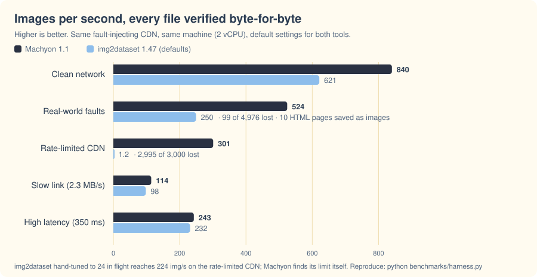
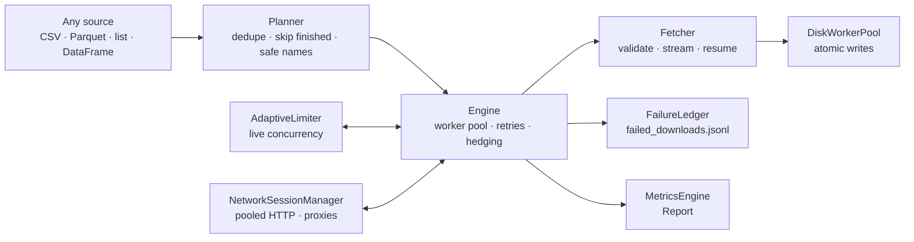

<p align="center">
  <a href="https://divyanshusingh96.github.io/machyon/"></a>
</p>

<p align="center">
  <a href="https://pypi.org/project/machyon/"></a>
  <a href="https://pypi.org/project/machyon/"></a>
  <a href="https://github.com/DivyanshuSingh96/machyon/actions"></a>
  <a href="https://github.com/DivyanshuSingh96/machyon/blob/main/LICENSE"></a>
  <a href="https://divyanshusingh96.github.io/machyon/"></a>
  <a href="https://colab.research.google.com/github/DivyanshuSingh96/machyon/blob/main/notebooks/machyon-colab.ipynb"></a>
</p>

<p align="center">
Machyon <em>(MAK-ee-on: <b>Mach</b> + tach<b>yon</b>)</em> is a new kind of image downloader.<br>
It pulls any number of images from any server, tunes its own speed while it runs,<br>
and <b>accounts for every file</b>: each one is downloaded, already on disk, or recorded with the reason it couldn't be.
</p>

```bash
pip install machyon
```

```python
import machyon

report = machyon.download("urls.csv", "images/")
print(report)
# 4980 downloaded, 0 already on disk, 20 failed in 12.3s (404.9 img/s, 8.10 MB/s) | failures: {'http_404': 14, 'not_image': 6}
```

That's it. No thread counts to tune, no retry loops to write, no half-written files to clean up.

No Python setup? [Open the Colab notebook](https://colab.research.google.com/github/DivyanshuSingh96/machyon/blob/main/notebooks/machyon-colab.ipynb): paste links or upload a CSV, and get the images back as a ZIP or in your Google Drive.

**[Read the documentation →](https://divyanshusingh96.github.io/machyon/)**

---

## The story

I was in college when my team entered the **Amazon ML Challenge**. The dataset was a CSV of product images: **263,859 rows**. Before we could train anything, we had to download them, and that's where the challenge really started.

A simple loop would have taken most of a day. The parallel scripts we tried went faster, but they died halfway, retried nothing, and quietly saved HTML error pages as `.jpg` files. Worst of all, when we finally had "everything", files were missing and nothing told us which ones. When time is the scarcest resource you have, losing it to *downloading* feels terrible.

So I started building the downloader I wished we'd had. A year of rewrites later, it's Machyon: fast enough that the network is the limit, and careful enough that "done" means **done**.

If you've ever stared at a progress bar while a deadline got closer, this is for you.

**In the Amazon ML Challenge right now?** There's a [one-cell recipe](https://divyanshusingh96.github.io/machyon/getting-started/amazon-ml-challenge/) that saves files under the same names as the starter kit's `download_images()`, so the rest of your notebook keeps working.

## The name, and Opa

**Mach** is the speed of sound. A **tachyon** is a hypothetical particle that can never travel slower than light.
**Machyon** is both: built to break the waiting barrier, and never fall back below it.

The mascot is **Opa**, an *Opabinia*: a real animal that swam in Cambrian seas more than 500 million years ago, with
five eyes and one long arm ending in a claw. Five eyes to watch every row, one reach to grab exactly what you asked for.
[Meet Opa](https://divyanshusingh96.github.io/machyon/project/meet-opa/), and watch the 25-second film about where it came from.

## The problem everyone hits

Downloading a lot of images *looks* trivial, until you do it for real:

| What happens | What it costs you |
|---|---|
| A sequential loop | Hours instead of minutes |
| Threads or async with a hard-coded number | Too low wastes your bandwidth; too high gets you **rate-limited (HTTP 429)** and everything fails |
| One slow server response | The whole batch waits for the slowest image |
| No retries, or naive retries | Transient errors become permanent holes in your dataset |
| `status == 200` is treated as success | **HTML "not found" pages saved as `image.jpg`**, discovered weeks later during training |
| The script crashes or you hit Ctrl+C | Half-written files that look complete, and no idea where to resume |
| The same URL appears on several rows | Silently skipped or downloaded twice |

## What Machyon does differently

**🚀 Self-tuning speed.** Concurrency adapts live. It ramps up while throughput improves, backs off within a second or two when a server says "slow down", and remembers the best setting per host for next time.

**🪃 No straggler tax.** No batches and no barriers: a continuous worker pool. Near the end, any image far slower than its peers gets a second, racing request (*hedging*). The first good answer wins.

**🛡️ Zero lost files.** Every row ends up written, skipped because it's already complete, or recorded with a reason in `failed_downloads.jsonl`. Files appear atomically, so a file that exists is a complete file, through Ctrl+C, crashes and full disks. [The exact contract, and where it stops](https://divyanshusingh96.github.io/machyon/reliability/zero-lost/).

**🔍 Real images only.** Bodies are checked by their magic bytes. HTML error pages are rejected, while real images served with odd content types (`application/octet-stream`) are accepted.

**🔁 Resume is just "run it again".** Finished files are skipped in a second or two, even for hundreds of thousands of rows (100,000 in 0.5 s). Large files resume mid-file with HTTP Range requests.

**🤝 Polite by design.** It honours `Retry-After`: after a 429 it sends nothing new to that host until the wait is over, while other hosts keep going. Retries use jittered backoff, and duplicate URLs are fetched once.

**🧩 A library first.** Use it from sync or async code, with any input (CSV, TSV, TXT, JSON, JSONL, Parquet, DataFrames, iterables), filename templates and typed reports. Small footprint: `aiohttp`, `tqdm`, and `truststore` + `certifi` for browser-grade HTTPS verification.

## Benchmarks

<picture>
  <source media="(prefers-color-scheme: dark)" srcset="https://raw.githubusercontent.com/DivyanshuSingh96/machyon/main/assets/benchmark-dark.svg">
  
</picture>

| Scenario (images) | Machyon 1.0 | img2dataset 1.47, defaults | img2dataset, best tuning |
|---|---|---|---|
| Clean network, 80 ms RTT (5,000) | **820 img/s**, 0 lost | 538 img/s, 0 lost | 565 (`retries=3`) |
| Real-world faults (5,000) | **519 img/s**, 0 lost, 0 bogus | 257 img/s, **97 lost, 10 bogus** | 268, 0 lost but **10 bogus** (`retries=3`) |
| Rate-limited CDN, max 48 in flight (3,000) | **343 img/s**, 0 lost | 0.6 img/s, **2,997 lost** | 222 (hand-tuned to 24 in flight) |
| Slow link, 2.3 MB/s (2,000) | **114 img/s** | 95 img/s | 96 |
| High latency, 350 ms (3,000) | 219 img/s | 214 img/s | 224 (`retries=3`) |

*Lost* means a row that could have succeeded but has no file. *Bogus* means a file that isn't the image: an HTML error page saved as `.jpg`.

**How this was measured.**
- Both tools downloaded from the same local fault-injecting CDN ([`benchmarks/fakecdn.py`](https://github.com/DivyanshuSingh96/machyon/blob/main/benchmarks/fakecdn.py)). The "real-world faults" scenario injects slow tails, 503s, dropped connections, stalls, 404s, HTML soft-404s and odd content types. Every saved file was compared byte-for-byte with the original.
- img2dataset was given its fastest raw-download settings: no resizing, no re-encoding, no EXIF or hash work, 2 processes.
- Times are wall-clock, including process start-up, on a 2-vCPU machine shared with the CDN.
- **Your numbers will differ.** On a fast connection Machyon is usually limited by the network, not by itself. Reproduce with [`benchmarks/harness.py`](https://github.com/DivyanshuSingh96/machyon/blob/main/benchmarks/harness.py).

**Where img2dataset is the better choice:** it's a superb tool built for a different job. It does resizing, WebDataset/Parquet shards, captions, and distributed runs on Spark or Ray for hundreds of millions of images on big clusters. Below that scale, on the machine you already have, Machyon is the embeddable, self-tuning downloader that accounts for every file.

## Quickstart

### Command line

```bash
machyon urls.csv -o images/                           # URL column detected automatically
machyon train.csv -o images/ --url-col image_link --names "{index}_{entity_name}{ext}"
machyon retry -o images/                              # retry what failed, under the same names
machyon names urls.csv --names "{host}/{hash}{ext}"   # preview filenames without downloading
machyon doctor "https://site.com/img.jpg"            # why does a URL fail? DNS, proxy, TLS, HTTP
```

### Python (sync)

```python
import machyon

report = machyon.download(
    "train.csv", "images/train",
    url_col="image_link",
    names="{index}_{entity_name}{ext}",   # any column + {index} {hash} {stem} {ext} {host}
)
print(report.downloaded, report.failed, report.rate)
print(report.failure_reasons)             # {"http_404": 12, "not_image": 3}
```

### Python (async, inside your app)

```python
async with machyon.Downloader("images/", headers={"Authorization": "Bearer …"}) as dl:
    report = await dl.download(urls, names="{host}/{hash}{ext}")
    await dl.retry_failed()
    print(dl.failures)   # [{"url": ..., "name": ..., "reason": ...}]
```

In Jupyter, FastAPI or any running event loop, use `await machyon.adownload(...)`.

## Inputs and filenames

| Input | Example |
|---|---|
| CSV / TSV / TXT / JSON / JSONL / Parquet | `machyon.download("urls.parquet", "out")` |
| a list or generator of URLs (streamed, memory stays flat) | `machyon.download(url_list, "out")` |
| `(url, filename)` pairs | `machyon.download([(u, "a/1.jpg"), ...], "out")` |
| URLs plus a list of names | `machyon.download(urls, "out", names_list)` |
| a pandas or Polars DataFrame | `machyon.download(df, "out", names="{label}/{index}{ext}")` |

Name templates use `{index}` (the row number), `{hash}` (stable and unique per URL; this is the default), `{stem}` and `{ext}` (from the URL), `{host}`, and any column of your table. When the URL has no image extension, `{ext}` becomes the **real** format detected from the bytes (`.jpg`, `.png`, `.webp`, …). A `/` in a template creates subfolders.

## Configuration

The defaults are tuned so you rarely need any of this. Every option works as a keyword (`machyon.download(..., max_retries=10)`) or through `DownloadConfig`:

| Option | Default | What it does |
|---|---|---|
| `concurrency` / `max_concurrency` | 32 / 256 | Starting point and ceiling for in-flight requests (adapts between them) |
| `adaptive` | `True` | Live concurrency tuning |
| `hedge` | `True` | Race a duplicate request against stragglers at the end of a batch |
| `max_retries` / `backoff` | 5 / 0.5 s | Retries after the first attempt; jittered exponential backoff |
| `timeout` / `max_request_time` | 15 s / 120 s | Connect and read-stall timeout; hard cap per attempt (extended for big files) |
| `headers`, `referer`, `user_agent` | | Auth tokens, cookies, identity |
| `validate` | `True` | Reject non-image bodies |
| `verify_existing` | `False` | Check that files already on disk really are images before skipping them |
| `fsync` | `False` | Flush to physical disk before each rename (power-loss safe, slower) |
| `metrics_dir` / `log_dir` | `None` | Append run summaries to JSON / write a rotating log |

When Python itself is the bottleneck (many small images on a fast link), install `pip install "machyon[fast]"` for uvloop (Linux/macOS) or winloop (Windows). `machyon.download()` and the CLI use it automatically; in your own code, call `machyon.run(main())` in place of `asyncio.run`.

Every option, with its CLI flag: [configuration reference](https://divyanshusingh96.github.io/machyon/reference/configuration/).

## How it works



The full design (algorithms, guarantees and the outcome table) is in [docs/ARCHITECTURE.md](https://github.com/DivyanshuSingh96/machyon/blob/main/docs/ARCHITECTURE.md). It's written language-neutral, because Machyon is coming to JavaScript next.

## Class-based API

Prefer explicit lists and step-by-step control? `ImageDownloader` and `ImageRenamer` give you exactly that, on the same engine:

```python
from machyon import ImageDownloader, ImageRenamer

links, names = ImageRenamer(entity_col="entity_name").hashed_names("train.csv")  # stable names
async with ImageDownloader(save_dir="images", max_retries=10) as d:
    await d.metrics_json(links, names)      # download + append a run summary to metrics/
    await d.retry_failed_downloads()
```

## Troubleshooting

Every failure is recorded in `failed_downloads.jsonl` with its reason **and the real error**, and the CLI explains each kind once ([every reason, explained](https://divyanshusingh96.github.io/machyon/reference/failure-reasons/)). For any URL that fails, ask the doctor:

```bash
machyon doctor "https://example.com/some/image.jpg"
```

It checks DNS, your proxy, each TLS trust source and the HTTP response, then tells you what to change: `--referer` for hotlink-protected sites, `--tls-trust certifi` if your OS store is missing a root, or, if something on your machine is re-signing HTTPS (antivirus "HTTPS scanning", a corporate proxy), how to deal with that.

## Responsible use

Machyon is fast, so please be a good citizen. Download only what you have the right to use, respect each site's terms and `robots.txt`, and identify yourself with a `user_agent` when you're collecting data at scale. Machyon helps: it honours `Retry-After`, sends nothing new to a host that answered 429 until the wait is over, and lowers its concurrency automatically. [Responsible use](https://divyanshusingh96.github.io/machyon/project/responsible-use/)

## Roadmap

- [x] Python library: adaptive concurrency, hedging, atomic writes, resume
- [ ] **JavaScript / TypeScript** (`npm i machyon`), on the same architecture and the same fault-injection suite
- [ ] Optional post-processing hooks (resize, convert, dedupe by perceptual hash)
- [ ] WebDataset / Parquet shard output
- [ ] Source plugins (sitemaps, cloud buckets)

## FAQ

**Is it really faster than my 20-line asyncio script?** On a clean network with the right concurrency, both will hit your bandwidth. Machyon's advantage shows up on real networks: it finds the right concurrency itself, doesn't stall on stragglers, survives rate limits, and doesn't lose files.

**How big can the input be?** Rows are read and planned in shards of 200,000. Machyon keeps about 70 bytes per row to catch filename conflicts across the whole run, which is roughly 0.7 GB per 10 million rows. Very large single folders are slow on every filesystem, so use a template like `{hash:.2}/{hash}{ext}` to spread files across subfolders.

**Does it work on Windows?** Yes. Filenames are made Windows-safe, and writes retry when antivirus or the search indexer briefly locks a file.

**Can it download from pages instead of URL lists?** Not yet; v1 takes URL lists. Page and sitemap sources are on the roadmap.

## Contributing

Bug reports, ideas and pull requests are very welcome; see [CONTRIBUTING.md](https://github.com/DivyanshuSingh96/machyon/blob/main/CONTRIBUTING.md). Running `pytest` covers 90+ tests in about two and a half minutes: fault injection against a fake CDN, plus every example in the documentation.

## Citing

If Machyon helps your research, please cite it ([CITATION.cff](https://github.com/DivyanshuSingh96/machyon/blob/main/CITATION.cff)).

## License

[MIT](https://github.com/DivyanshuSingh96/machyon/blob/main/LICENSE) © 2026 Divyanshu Singh
