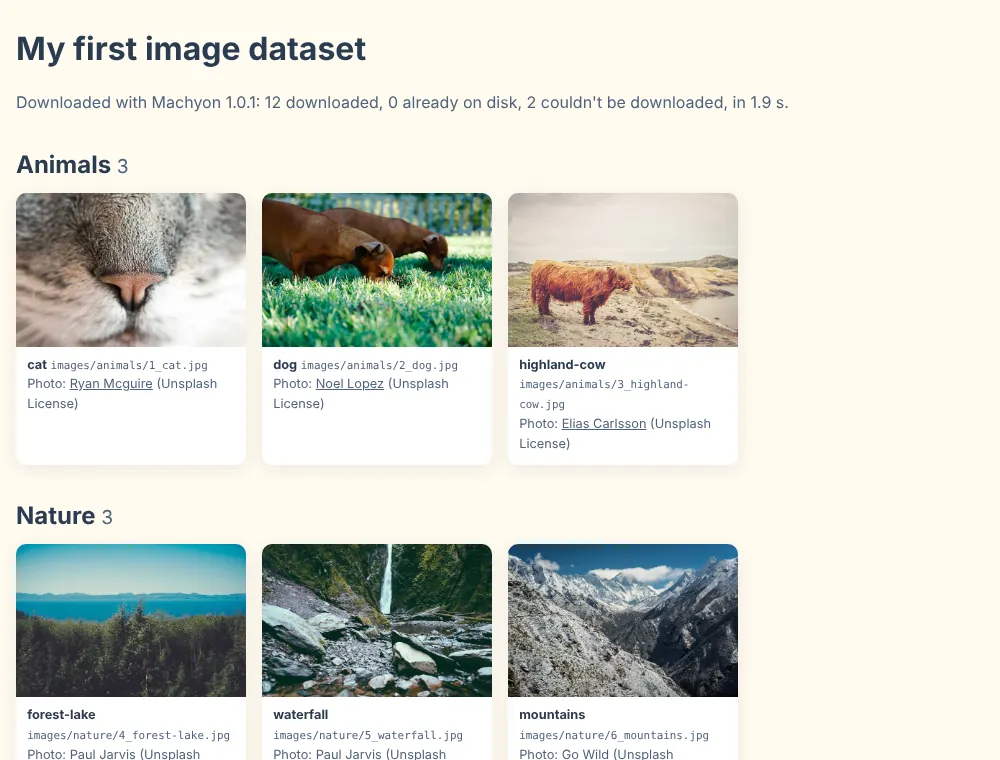
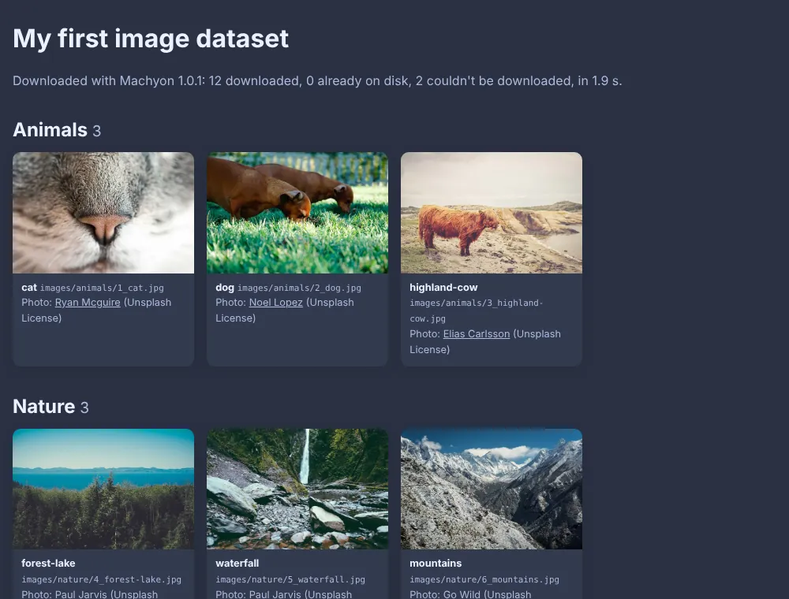

# Build your first image dataset

<p class="lead">Turn a spreadsheet of image links into a folder of images sorted by category, a report of what
happened, and a gallery you can open in your browser. One Machyon call does the downloading.</p>

<div class="mx-lab-levels compact" role="note" aria-label="About this project">
  <div><b>Level</b><span>Beginner</span></div>
  <div><b>Uses</b><span><code>machyon.download()</code>, filename templates, the <code>Report</code></span></div>
  <div><b>Time</b><span>About 10 minutes</span></div>
</div>

## What you will build

A script that reads a CSV of 14 image links, downloads them into folders by category, and writes a gallery page.
Here is the gallery from a real run:

{ .mx-only-light .mx-shot }
{ .mx-only-dark .mx-shot }

Two of the 14 links are broken on purpose, so you also see what Machyon does when a download can't succeed.

## What you will learn

- How to download a whole table of links with one function call.
- How to tell Machyon which column holds the URL.
- How to name and sort files using your own columns, with a filename template.
- How to read the `Report`: what was downloaded, skipped, or failed, and why.
- Why "the server answered" is not the same as "you got an image".
- What happens when you run the same download again.

## How it works

```text
manifest.csv ──► machyon.download() ──► dataset/images/<category>/<id>_<name>.jpg
                         │                 dataset/images/failed_downloads.jsonl
                         ▼
                      Report ──────────► dataset/report.json
                                         dataset/gallery.html  (built from the files on disk)
```

The gallery is built from the files that are actually on disk, not from the manifest, so it can't show an image
that wasn't downloaded.

## Requirements

- Python 3.11 or newer.
- An internet connection (the photos come from [Picsum Photos](https://picsum.photos/)).

## Installation

Make a folder for the project, and inside it a virtual environment:

=== "Windows (PowerShell)"

    ```powershell
    python -m venv .venv
    .venv\Scripts\Activate.ps1
    pip install machyon
    ```

=== "macOS and Linux"

    ```bash
    python -m venv .venv
    source .venv/bin/activate
    pip install machyon
    ```

Then save the two files below into that folder, as `manifest.csv` and `build_dataset.py`. You'll find both in the
repository too, in
[`examples/cookbook/first_dataset/`](https://github.com/DivyanshuSingh96/machyon/tree/main/examples/cookbook/first_dataset).

!!! note "Working on Machyon itself?"
    From a clone of the repository, install your local copy instead with `pip install -e .`, then run the script
    from `examples/cookbook/first_dataset/`.

## The manifest

Each row is one image: an `id`, a `name`, a `category`, the `image_url`, and who took the photo. The photos are by
the photographers named in each row, shared on Unsplash under the
[Unsplash License](https://unsplash.com/license); the manifest only lists links to them.

```csv title="manifest.csv"
--8<-- "examples/cookbook/first_dataset/manifest.csv"
```

The last two rows are the deliberately broken ones: a photo that doesn't exist, and a link to a web page instead of
an image.

## The script

```python title="build_dataset.py"
--8<-- "examples/cookbook/first_dataset/build_dataset.py"
```

Run it:

```bash
python build_dataset.py
```

## Understanding the Machyon API

All the downloading is this one call:

```python
report = machyon.download(manifest, images, url_col="image_url", names="{category}/{id}_{name}{ext}")
```

- **`manifest`**: the input. Machyon reads CSV files directly; it also reads TSV, TXT, JSON, JSON Lines, Parquet,
  DataFrames and plain lists (see [Input sources](../guides/input-sources.md)).
- **`images`**: the folder to download into. Machyon creates it, and any folders the names need.
- **`url_col="image_url"`**: which column holds the link. Here Machyon would find it anyway, because `image_url`
  is one of the column names it recognises (with `url`, `image_link`, `link` and a few others), but naming it
  makes the script clearer and keeps working if you add another link column.
- **`names="{category}/{id}_{name}{ext}"`**: a [filename template](../guides/naming.md). `{category}`, `{id}` and
  `{name}` come from each row's own columns; `{ext}` is the image's real format. The `/` makes a folder per
  category.
- **`report`**: a `Report`. `report.downloaded`, `report.skipped` and `report.failed` always add up to the number of
  rows; `report.failure_reasons` counts why rows failed, and `report.to_dict()` gives you everything as a dictionary
  (that's what `report.json` is).

## Expected output

From a real run:

```text
12 downloaded, 0 already on disk, 2 failed in 1.9s (6.2 img/s, 0.28 MB/s) | failures: {'not_image': 1, 'http_404': 1}
```

```text
dataset/
├── gallery.html
├── report.json
└── images/
    ├── animals/   1_cat.jpg  2_dog.jpg  3_highland-cow.jpg
    ├── city/      7_bridge-at-night.jpg  8_street.jpg  9_canal.jpg
    ├── nature/    4_forest-lake.jpg  5_waterfall.jpg  6_mountains.jpg
    ├── objects/   10_mug.jpg  11_record-player.jpg  12_clock.jpg
    ├── broken/    (empty: nothing is left behind for rows that failed)
    ├── failed_downloads.jsonl
    └── failed_downloads.txt
```

The two failures are in `failed_downloads.jsonl`, one JSON line each:

```json
{"url": "https://picsum.photos/id/100000/640/427.jpg", "names": ["broken/13_missing-photo.jpg"], "reason": "http_404", "error": "HTTP 404 Not Found"}
{"url": "https://picsum.photos/", "names": ["broken/14_not-a-photo.{ext}"], "reason": "not_image", "error": "Content-Type text/html, body starts b'<!doctype html>...'"}
```

The second one is the important lesson. That link answered **200 OK**, the code that usually means success, but
what came back was a web page. Machyon checks the first bytes of every download, saw HTML instead of an image, and
refused to save it as a `.jpg`. Its name still says `{ext}` because no image format was ever found.

## Run it again

Run the same command a second time:

```text
0 downloaded, 12 already on disk, 2 failed in 0.6s (0.0 img/s, 0.00 MB/s) | failures: {'not_image': 1, 'http_404': 1}
```

The 12 photos are already there, so they're skipped in well under a second. The two broken rows are tried again,
because maybe they work now; they don't, so they're recorded again. This is also how you resume a download that was
interrupted: run the same command.

## Experiment with it

- **Change the folders:** use `names="{name}/{id}{ext}"` and see the layout change. Add `{hash}` for names that can
  never collide.
- **Add your own rows:** any direct link to an image works. Add a row with a new category and run it again: only
  the new image is downloaded.
- **Try another format:** save the manifest as JSON Lines (one object per line with the same keys) and pass that
  file instead. The rest of the script doesn't change.
- **Read the report in Python:** print `report.failure_examples` to see each failure reason with an example URL and
  a hint.

## Troubleshooting

- **Every row failed with a connection error:** check your internet connection, or whether a proxy is required.
  `machyon doctor` checks your setup.
- **An error about an unknown key in the template, before anything downloads:** every `{...}` in `names` must be a
  column of the manifest or one of `{index}`, `{hash}`, `{stem}`, `{ext}` and `{host}`. The error lists the keys
  you can use.
- **The gallery shows nothing:** open it from the `dataset` folder, next to `images/`, because it uses relative
  paths.

More in [Troubleshooting](../troubleshooting/index.md).

## Next

- [Adaptive Concurrency Lab](../lab/adaptive-concurrency.md): watch what Machyon does when a server says "too many".
- [Amazon ML Challenge](../getting-started/amazon-ml-challenge.md): the same idea at 263,859 rows.
- [The failure ledger](../reliability/failure-ledger.md): everything in `failed_downloads.jsonl`, and how to retry.
